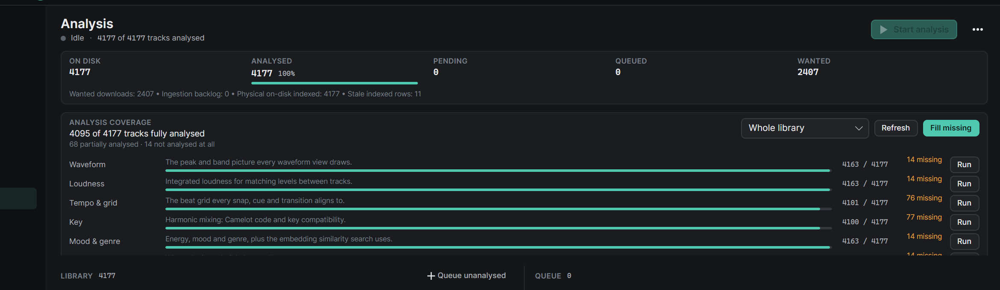

# ORBIT 0.20.0-alpha — release notes

**Released:** 2026-10-28 · **Previous public build:** 0.10.0-alpha (2026-10-24) · **Runtime:** win-x64,
self-contained single file.

This is a cumulative alpha covering everything merged into `master` since the 0.10.0-alpha package:
23 commits, 231 files, +17.7k / −2.3k lines. The version jumps to **0.20.0** because this is a
milestone build rather than a patch on 0.10 — it is still an alpha, and it upgrades 0.10.0-alpha in
place (same installer AppId). Three themes run through it:

1. **Honest analysis.** The Analysis page can finally say a track is *incomplete* — per engine — and
   repair only what is missing. The old page invented analysis data for every row, so "missing"
   could never fire.
2. **DJ-prep hardening.** Cue Forge got a full-track workflow (docked track list, tri-band waveform,
   grid repair, intro timing, Rekordbox cue import), automatic mixes now hand over on the second
   drop, and export is protected by a preflight instead of overwriting things.
3. **Player intelligence.** Flow Mode actually plans (it never ran before), explains every pick, and
   drives what plays next; the fullscreen player no longer fades its own controls back and forth.

---

## Before you start (upgrade notes)

- **Database.** `audio_features` gains a nullable `TimeTillDropSeconds` column (EF migration
  `20261028143000_AddTimeTillDropSeconds` plus the usual runtime `ALTER` in `SchemaMigratorService`).
  Existing rows stay `NULL` until backfilled. No re-import, no manual SQL.
- **Two one-time passes run after first launch**, both writing a backup first:
  - `TimeTillDropBackfillService` — 30 s after startup, computes time-to-first-drop from stored
    energy curves only (no audio decode). Marker: `%APPDATA%\ORBIT\Backups\time-till-drop-v1.done`.
  - `CueLayoutRepairService` — 90 s after startup, regenerates auto cues that sat in the outro,
    renames `[IN -N]` countdowns to `[IN2 -N]`. Backup:
    `library.db.bak-cue-layout-v2-<timestamp>`.
- **Analysis version.** New passes stamp `2026.10.28-triband-v2`. Old cached waveforms show a banner in
  Cue Forge with **Refresh full analysis**; nothing is re-analysed silently.
- **Playlist order changes once.** Manual ordering (`ManualSortOrder`) now persists, so the tree
  switches from creation-date order to your manual arrangement on first run.
- **New on-disk state.** Per-playlist view state (search, filters, sort, widths, scroll) lives in a
  `LibraryViewState` folder beside `library.db`; delete it to reset.
- **FFmpeg (Windows x64).** ORBIT now installs its own pinned, SHA-256-verified build on first run
  (~110 MB, one time). Linux/macOS get the exact install command instead.
- **New config keys:** `Cues:CountdownsAsMemoryCues`, `Waveform:*` layer/gain keys.

---

## Analysis — per-engine coverage and repairs

The Analysis page could not report an incomplete track: every library row was mapped with a
fabricated `AnalysisData`, so the ✓, "M of M analysed" and "analysis missing" were always wrong.
Completeness is now measured from stored output.

- **ANALYSIS COVERAGE card** — "92 of 140 tracks fully analysed", plus "x partially analysed ·
  y not analysed at all", scoped to a playlist or the whole library.
- **Playlist picker** in the card; only downloaded tracks whose file is actually on disk are counted,
  matched by hash (never by row position).
- **Eight engine rows** — Waveform, Loudness, Tempo & grid, Key, Mood & genre, Structure, Cues,
  Fingerprint — each with its purpose, a completion meter, `4163 / 4177` and `14 missing`.
- **Run one engine** per row, or **Fill missing** for the whole selection: only tracks in the
  selection are queued, each with only its own gaps; complete tracks are skipped and duplicate
  playlist rows collapse into one request.
- **Refresh** re-reads stored output on demand; the card also reloads after a successful analysis
  (throttled 500 ms) and ignores responses for a playlist you already navigated away from.
- **Library rows** gained a "Missing Key, Cues and Fingerprint" line and a button that queues exactly
  those engines for that track.
- **No more fabricated rows.** A track with nothing measured no longer looks analysed; defaults
  (0 BPM, `[]`, a bare energy curve, CUE-DETR inspector JSON) never prove an engine ran.
- **Partial runs are gated.** `TrackAnalysisRequestedEvent` carries an engine mask and
  `AnalyzeFileAsync` scopes PCM, Essentia, grid and cue work to the requested engines. Structure-only
  runs leave cue rows alone; cues-only runs regenerate cues without bumping `StructuralVersion`.
- **Failures are failures.** A cues-only run that produces no cues, or a run that leaves requested
  outputs absent, now reports a real error with a reason instead of completing as a no-op.

## Flow Mode (the player's Flow toggle)

Flow was a fully written engine with **no caller** — `RebuildFlowPathAsync` was never invoked, so
turning Flow on produced a blank panel. It now plans, explains, and drives playback.

- **What it scores:** Camelot-wheel key distance, ratio-aware tempo (1:1, 2:1, 1:2, 3:2 — 87 next to
  174 BPM is a match), energy versus a per-hop target, and mood/genre affinity; recent tracks and
  same-artist repeats are damped.
- **A path, not a guess:** five hops, each scored against the hop before it, with a deterministic
  tie-break so the same inputs always produce the same set.
- **The card shows the reasoning:** next track with `172.0 BPM · 12B · Energy 0.78`, a bar plus real
  numbers per axis (`Key · 8A → 8B · Compatible (+1)`, `Tempo · 128.0 → 174.0 BPM · 2:3 ratio (±12.0)`),
  the crossfade it will use, and the next four hops.
- **Tuning:** *Optimise for* (Silky Smooth / Club Banger / Radio Perfect / Genre Bender) and an Energy
  slider that bends the whole arc.
- **It drives playback:** preload, the Next button and the automatic hand-over all follow the plan.
  Shuffle and Flow stand each other down (the one you switched on last wins).
- **Never a blank panel:** with Flow off the card explains itself; with nothing to work from it says
  why ("This track has no BPM, key or energy yet…", "Nothing else is queued…", "None of the other
  queued tracks are analysed yet…") and how many queued tracks it could use.

## Cue Forge & waveform

- **Docked track list** on the left (playlist picker, title/artist filter, "Track 3 of 24", click to
  open) replaces the header Tracks flyout.
- **Preparation menu** gathers generation, cue template, Rekordbox cue import, grid repair and
  shortcuts; Undo/Redo moved to the header; the toolbar wraps instead of scrolling.
- **Layers flyout:** energy curve, onset density, vocal ghost, phrase sections and beat grid, plus
  Fit/150%/200% display gain. Only the beat grid is on by default.
- **Tri-band waveform rewrite:** each column keeps its strongest sample instead of averaging, so
  kicks and drop edges survive; a scaling bug that cropped waveforms at 150% is fixed.
- **Cue labels** use up to three lanes (selected cue first) and hide unplaceable labels; the overview
  strip shows A–H pad badges.
- **Grid repair:** Bar 1 here, −10/+10 ms slip, Reset, beat jump — saved to the track's analysis,
  never moving cues. Beat-jump buttons with 1/4/8/16/32-bar sizes (`[` and `]`).
- **Stale-waveform banner** with Refresh full analysis, progress, failure text and retry; unsaved cue
  edits are saved first.
- **Responsive:** below 1000 px the prep area becomes three tabs; below 700 px height it collapses
  and restores at 760 px; a splitter resizes the dock.

## Drops, intro timing and transitions

- A second drop within 16 bars of the track end or of Drop 1 is omitted, instead of being clamped
  into the outro with countdowns and an OUT cue.
- `[OUT]` is only placed when at least four bars remain after the last drop.
- Drop-2 countdowns are `[IN2 -16]` / `[IN2 -8]` so CDJ screens show distinct labels; legacy
  `[IN -N]` cues still link to their drop.
- **Countdowns as memory cues** (Preparation menu, cue inspector) frees pads A B D E; drops stay on
  C and F on every track.
- **Intro timing** in Cue Forge's track bar and the Library inspector: time to first drop in seconds
  and bars, and intro length in 4/4. It uses the earliest usable drop, not the strongest, and shows
  "—" when nothing was found.
- **Transition editor Share** saves the current mix-out/mix-in as reusable Mix-In/Mix-Out cues, which
  the planner prefers over structural estimates.
- Auto-generated cues keep the shared pad layout; your own cue wins a contested pad and the generated
  cue becomes a memory cue.

## Mix hand-over on the second drop

- An automatic mix of a tempo-matched, energetic pair now hands over on the outgoing track's **second
  drop** rather than its outro, so the incoming drop lands on a drop.
- **Drop Sync** is planned by default for those pairs: mix out 16 bars before Drop 2 (8 when the
  incoming drop comes sooner than 16 bars after its intro) and enter the same distance before the
  incoming Drop 1, so the drops meet across a 16- or 32-bar blend.
- Approach markers only count when their stated bar count *and* position match, so Drop 1's `[IN -16]`
  can no longer be used as Drop 2's.
- A DJ-marked outro still wins (the planner blends inside it and may leave before half the track);
  otherwise the fair-run floor is half the outgoing track, or a quarter for a drop-2 hand-over.
- If a drop-to-drop window would clash both tracks' vocals, the plan falls back to Rolling.

## Library and playlist UX

- Each playlist remembers its own search, filters, sort, column widths and scroll position, restored
  when you switch back or restart.
- Drag one playlist onto another to insert it before or after, with a drop line showing where it lands.
- A new **PREP** column labels each row *Locate file*, *Analyse*, *Set grid*, *Add cues* or *Export
  ready*, with the repair action inline.
- Columns resize by dragging; widths persist and less important columns fold instead of clipping.
- Select All covers the whole filtered playlist (not just loaded rows); Deselect All clears highlights.
- Narrow windows wrap sidepanel tabs and the Inspector action bar instead of hiding them.
- **Workstation Locate** relinks a moved file in every playlist, restores Downloaded status and keeps
  its cues, grid and analysis.

## Import

- CSV import accepts comma, semicolon, tab and pipe files, including Excel's Windows-1252 saves.
- Headers match by alias (Track Name, Song, Titel, Titre); a file with no title column is refused and
  lists the columns it did find.
- The import preview says which columns were used and which rows were skipped.
- Spotify links retry the public page when the API refuses a playlist; failures now read plainly
  (account not allowlisted, rate-limited, sign-in expired) and only offer Connect when it would help.

## Rekordbox and export safety

- **New RekordboxBridge companion** (`Tools\RekordboxBridge`) opens Rekordbox 6/7's encrypted
  `master.db` read-only in its own process — the app's SQLite engine is untouched.
- Cue Forge loads a track's hot cues, memory cues and loops from Rekordbox, matched by file path;
  Rekordbox cues keep their colours and beat auto cues (a pad clash demotes the generated cue to a
  memory cue).
- **Export preflight** blocks missing files, invalid BPM, broken or non-increasing grids, out-of-range
  cues and corrupt cue JSON before anything is written.
- Re-exporting into an existing Rekordbox XML keeps every non-empty Rekordbox value unless you confirm
  replacing it; an XML ORBIT cannot parse is left untouched and blocks the export.
- Cue export no longer stops at 32 cues per track, and repeated playlist entries keep their positions.
- Cue-sync baselines are only recorded after the atomic write and XML verification both succeed.

## Diagnostics and first-run setup

- **Send feedback** (top bar, Ctrl+Shift+F) zips a screenshot, your note, system info and the last
  15 minutes of logs — nothing is uploaded, and passwords, tokens and your Windows user name are
  scrubbed. The zip path is put on the clipboard.
- **Setup → THIS PC** switches off analysis, AI tagging or stem separation, with the reason, when the
  machine can't run them; auto-analysis is disabled and explained rather than failing silently.
- **FFmpeg self-install** on Windows x64 (pinned build, SHA-256 verified, ~110 MB) with progress in
  the wizard and at startup; a failed install is reported instead of surfacing as a decode error.

## Player and Cue Forge fixes

- Play on a **stopped** deck now starts audio (the toggle only resumed a paused deck, so Cue Forge's
  cue clicks did nothing until the track had been played from the Library).
- **Space** is handled in the tunnel phase, so a focused button can't swallow it: it stops an active
  prelisten or toggles play/pause, and you can freeze the playhead to drop a cue.
- **Fullscreen player:** the chrome no longer fades out and pops back on its own. A stationary cursor
  no longer counts as activity when the seek thumb or queue list moves underneath it, fading is
  idempotent, and the chrome never fades while paused.

## Visualizer

- A continuous **morph** signal (three incommensurate sines scaled by beat and level) drives hue,
  rotation, scale, warp and ripple timing across every preset.
- Hue cycles up to ±45°; circular wave and starburst spin faster with bass/energy; spectrum bars grow
  with bass and lift on beats; ripples trigger sooner and add a second slow ring on loud bass.

## Performance

- Startup no longer eagerly loads every library project or runs a second library-entry sync before the
  first window; the Library page loads projects on first navigation.
- Download Centre hydration inserts only missing rows and batches additions in one DynamicData edit,
  so filters/sorts recompute once instead of per track.
- Playlist mosaics composite, encode and decode off the UI thread.
- Analysis workers default to `min(cores/2, memory budget, 8)` (4 GB reserved, ~768 MB per worker).
- Effnet mel filterbank/Hann tables are built once instead of per worker; Effnet sessions load behind
  a lock with one intra/inter-op thread each, and classifier heads run on CPU.

---

## Verification

- `dotnet build` (Debug and Release): **0 errors** (39 pre-existing warnings).
- Full test suite on this tree: **2683 passed, 11 skipped, 0 failed** (2694 total).
- Architecture guards green, including new ratchets for Flow wiring (`FlowModeWiringGuardTests`) and
  the fullscreen idle regression (`FullscreenPlayerIdleGuardTests`).
- New coverage since 0.10.0-alpha includes: `AnalysisCoverageAnalyzerTests`,
  `AnalysisCoverageServiceTests`, `CueForgeViewModelEditingTests` (29),
  `PlaylistExportIntegrityTests`, `TimeTillDropBackfillServiceTests`, `CueLayoutRepairServiceTests`,
  `IntroTimingTests`, `RekordboxLibraryServiceTests`, `FeedbackReportServiceTests`,
  `HardwareCapabilitiesTests`, `FlowPathPlannerTests`, `FlowModeServiceTests`, `PlayerViewModelFlowTests`.

## Known issues / limitations

- **Analysis coverage is not versioned per engine.** An engine upgrade does not mark old output stale;
  use per-row **Run** to force a refresh.
- **Coverage's queue dedupe is keyed by track hash only**, so a second partial request for a track
  that is already queued is dropped.
- **The coverage card is a capped scroll strip** — on a tall window the eighth engine row needs a
  scroll to reach.
- **Cue Forge's onset-density layer choice is not persisted**; and existing `config.ini` files without
  `[Waveform]` keys keep energy/vocal/phrase overlays on despite the new defaults.
- **Flow Mode plans from the queue.** It needs at least one other playable, analysed queued track; it
  does not pull from the library on its own.
- **Rekordbox reading needs the companion** — a build without `Tools\RekordboxBridge` reports that the
  reader is missing (the release script publishes it; a plain `dotnet build` puts it beside the exe).
- **First launch after upgrade does disk work** (two one-time backfills, backup files) and, on Windows
  x64 without FFmpeg, a ~110 MB download.

## Artifacts

| File | What it is |
|---|---|
| `artifacts/ORBIT-Setup-0.20.0-alpha-win-x64.exe` | Per-user installer (no admin prompt), shortcuts, uninstaller |
| `artifacts/ORBIT-0.20.0-alpha-win-x64.zip` | Portable package (same publish output) |
| `artifacts/ORBIT-0.20.0-alpha-win-x64-manifest.txt` | Version, runtime, configuration, publish timestamp |

Install and uninstall both leave `%APPDATA%\ORBIT` (library database, config, fingerprints, stems)
untouched, so reinstall never costs you your library.
